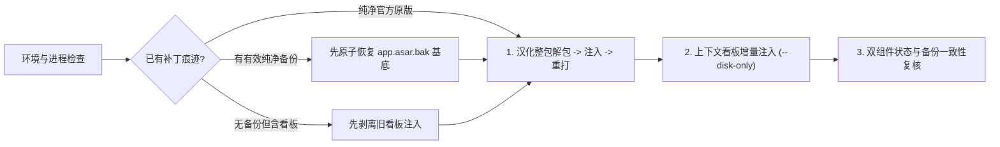

<div align="center">

# Antigravity Chinese Suite

**Google Antigravity 桌面端中文套件：简体中文深度汉化 + 对话上下文 / Token 用量看板**

一个仓库、一套跨平台编排器，将两个 MIT 开源组件按安全顺序幂等集成，支持一键安装、诊断与无损还原。

[](https://github.com/wangyudawang1/Antigravity-Chinese-suite/actions/workflows/ci.yml)
[](https://github.com/wangyudawang1/Antigravity-Chinese-suite/releases)
[](https://github.com/wangyudawang1/Antigravity-Chinese-suite)
[](https://github.com/wangyudawang1/Antigravity-Chinese-suite)
[](https://nodejs.org/)
[](LICENSE)

</div>

---

## 为什么需要这个套件？

Google Antigravity 官方客户端仅提供英文界面，也缺少当前会话上下文占用与各模型剩余额度的实时面板。社区已有两个优秀的独立补丁项目，但**两者都需要改写同一个 `resources/app.asar`**——如果先后顺序错误或重复安装，极易互相覆盖甚至导致客户端白屏。

本套件通过统一编排器 [`scripts/suite.js`](scripts/suite.js) 解决协同问题：



| 组件 | 核心能力 | 上游仓库 | 收录版本 |
| :--- | :--- | :--- | :--- |
| **chinese-localization** | 菜单、侧栏、设置、权限、SSH、Computer Use 等 4,800+ 词条深度汉化，保留模型名与思考链英文 | [antigravity-cn-community/Antigravity-Chinese-Localization](https://github.com/antigravity-cn-community/Antigravity-Chinese-Localization) | `e66b515` (`2.35.0`) |
| **context-viewer** | 顶栏额度圆环、当前上下文占用、生成速度、Token 历史统计与热力图、附件审计 | [elviscjn-cjn/antigravity-context-viewer](https://github.com/elviscjn-cjn/antigravity-context-viewer) | `v0.9.2` |

---

## 前置条件

- **Node.js ≥ 22.4.0**（安装全部组件或仅看板时需要 `22.4+`；若使用 `--skip-viewer` 仅装汉化，仅需 `18.18+`）
- **完全退出 Antigravity**：包括 Windows 系统托盘图标内的「退出」，确保无 `Antigravity` / `language_server` 进程占用文件（也可加 `--force-stop` 自动结束）
- **无需管理员权限**（Windows 默认安装在 `%LOCALAPPDATA%\Programs\antigravity`）

---

## 快速开始

### Windows 用户

直接克隆或下载解压后，双击对应批处理即可：

- **`一键安装.bat`** —— 安装「简体中文汉化 + 上下文看板」
- **`环境诊断.bat`** —— 运行全项体检（Node 版本、客户端路径、备份纯净度、`@electron/asar` 缓存、进程占用）
- **`查看状态.bat`** —— 查看当前汉化与看板的注入状态
- **`一键卸载.bat`** —— 先卸载看板，再校验版本后无损恢复官方英文原版

也可以在 PowerShell 中传参使用：

```powershell
# 完整安装（支持自定义安装目录、自动结束进程、预演）
powershell -NoProfile -ExecutionPolicy Bypass -File .\install.ps1
powershell -NoProfile -ExecutionPolicy Bypass -File .\install.ps1 -AppDir "D:\Apps\Antigravity" -ForceStop

# 仅安装简体中文汉化 / 仅安装上下文看板
powershell -NoProfile -ExecutionPolicy Bypass -File .\install.ps1 -SkipViewer
powershell -NoProfile -ExecutionPolicy Bypass -File .\install.ps1 -SkipLocalization

# 仅移除上下文看板（保留中文汉化）
powershell -NoProfile -ExecutionPolicy Bypass -File .\uninstall.ps1 -OnlyViewer

# 预演安装步骤（不改动任何文件）
powershell -NoProfile -ExecutionPolicy Bypass -File .\install.ps1 -DryRun
```

### macOS / Linux 用户

```bash
# 环境诊断
./doctor.sh

# 一键安装（macOS 若自定义路径可传 --app-dir "/Applications/Antigravity.app"）
./install.sh

# 查看状态 / 卸载还原
./status.sh
./uninstall.sh
```

> **macOS 签名提示**：修改 `app.asar` 后系统可能拦截启动，安装器会在结束时打印修复命令：
> `xattr -cr "/Applications/Antigravity.app" && codesign --force --deep --sign - "/Applications/Antigravity.app"`

### npm / Node CLI（全平台通用）

```bash
npm run doctor          # 环境诊断
npm run install-suite   # 一键安装
npm run status          # 查看状态
npm run uninstall-suite # 一键卸载
npm run check-upstream  # 检查两个上游是否有新版本
npm test                # 运行套件自动化测试
```

---

## 全部命令与参数参考

`scripts/suite.js <command> [options]`

| 参数 | 适用命令 | 说明 |
| :--- | :--- | :--- |
| `--app-dir <path>` | 全部 | 指定 Antigravity 安装目录（macOS 可直接传 `.app` 或 `.app/Contents`） |
| `--skip-localization` | `install` | 跳过汉化，只安装上下文看板 |
| `--skip-viewer` | `install` | 跳过上下文看板，只安装简体中文汉化（Node ≥ 18.18 即可） |
| `--only-viewer` | `uninstall` | 只卸载上下文看板，保留已安装的简体中文汉化 |
| `--remove-backup` | `uninstall` | 还原官方原版后同时删除 `app.asar.bak` |
| `--force-stop` | `install` / `uninstall` | 自动结束正在运行的 `Antigravity` 与 `language_server` 进程 |
| `--yes` / `-y` | `install` / `uninstall` | 非交互模式（若客户端仍在运行且未加 `--force-stop` 则安全退出） |
| `--dry-run` | `install` / `uninstall` | 预演执行计划，不修改任何磁盘文件 |
| `--json` | `status` / `doctor` | 输出结构化 JSON（便于脚本集成或提交 Bug 反馈） |

---

## 常见问题 (FAQ)

<details>
<summary><b>1. Antigravity 官方自动更新后汉化和看板没了怎么办？</b></summary>

Antigravity 自动更新会用新版本覆盖 `resources/app.asar`。只需重新运行一次 `一键安装.bat`（或 `./install.sh`）即可；脚本会自动识别版本变化并刷新对应的 `app.asar.bak` 备份。

</details>

<details>
<summary><b>2. 首次运行汉化时在「重新打包 app.asar」步骤卡住或报错？</b></summary>

`chinese-localization` 在本机打包时需要 `@electron/asar`。如果本地尚未缓存，首次运行会通过 `npx` 自动拉取。国内网络若拉取缓慢，可在终端设置镜像后重试：

```powershell
$env:npm_config_registry = "https://registry.npmmirror.com"
.\一键安装.bat
```

</details>

<details>
<summary><b>3. 重复运行安装脚本会把之前的补丁叠在一起导致白屏吗？</b></summary>

不会。`scripts/suite.js` 在重新安装前会先检查 `app.asar` 与 `app.asar.bak`：只要存在同版本纯净官方备份，就会先原子恢复纯净基底，再按「汉化 → 看板」顺序重打；即使没有备份但已含旧看板，也会先剥离旧看板再汉化。

</details>

<details>
<summary><b>4. 如果在安装后想单独移除看板、保留中文界面可以吗？</b></summary>

可以。运行 `.\uninstall.ps1 -OnlyViewer` 或 `node scripts/suite.js uninstall --only-viewer`。

</details>

---

## 目录结构

```text
Antigravity-Chinese-suite/
├─ scripts/
│  ├─ suite.js                        # 跨平台统一编排器（install / uninstall / status / doctor）
│  ├─ asar-version.js                 # 读取 ASAR 归档版本号
│  └─ check-upstream.js               # 检查两个上游仓库版本更新
├─ 一键安装.bat / install.ps1 / install.sh
├─ 一键卸载.bat / uninstall.ps1 / uninstall.sh
├─ 查看状态.bat / status.ps1 / status.sh
├─ 环境诊断.bat / doctor.ps1 / doctor.sh
├─ components/
│  ├─ chinese-localization/           # 上游汉化组件（MIT, © 2026 aabbWei）
│  └─ context-viewer/                 # 上游看板组件（MIT, © 2026 Antigravity Context Viewer Contributors）
├─ tests/suite.test.js                # 套件自动化测试（node:test）
├─ .github/workflows/ci.yml           # Windows + Ubuntu 双平台 CI
├─ NOTICE.md                          # 上游署名、精简说明与二次分发条款
├─ CHANGELOG.md                       # 版本变更记录
└─ LICENSE                            # MIT License
```

---

## 上游署名与免责声明

- 本仓库为第三方整合打包与编排工具，非 Google 官方发行版，亦不代表两个上游项目立场。
- 组件各自版权归原作者所有，均以 **MIT License** 分发，详见 [NOTICE.md](NOTICE.md) 与各自目录下的 `LICENSE`。
- 补丁会改写本地 `resources/app.asar`。脚本默认在修改前建立版本校验备份并在失败时中止，但仍建议保留官方安装包以备不时之需；使用本套件带来的风险由使用者自行承担。
